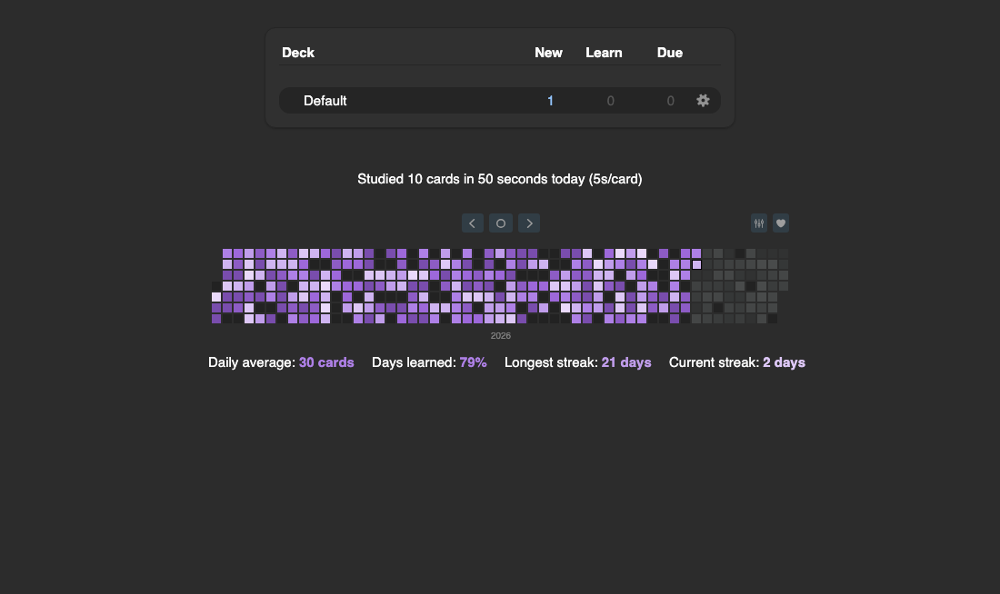

# Review Heatmap (modernised fork)

<a href="https://madebyhuman.iamjarl.com"><picture><source media="(prefers-color-scheme: dark)" srcset="https://madebyhuman.iamjarl.com/badges/co-created-white.svg"></picture></a>

A calendar heatmap of your past and future Anki reviews on the deck browser, deck overview, finished-deck screen and legacy statistics window, with streak statistics. Clicking a day opens the cards reviewed or due on that day in the browser.

**This is a modified version of Review Heatmap, not the original program.** It targets Anki 25.09 and 26.09 and is maintained independently of the upstream project. Based on the Anki add-on [Review Heatmap](https://github.com/glutanimate/review-heatmap/) by Glutanimate. [Click here to support Glutanimate's work.](https://glutanimate.com/support-my-work/)

> [!NOTE]
> This fork was improved with the help of Claude, with turquoise-turtle directing and testing the work. Glutanimate has not reviewed or endorsed these changes.




## What changed from upstream 1.0.1

Compatibility and robustness:

- Works on Anki 25.09 and 26.09 (Python 3.13, Qt 6). The vendored `libaddon` layer, whose Python 3.10+ incompatibilities crashed the add-on on current releases (upstream issues 217 and 218), is gone.
- Reviews land on the correct calendar day across daylight-saving transitions. Day bucketing is done in local wall-clock time, and the web layer maps days through their date rather than the current UTC offset (upstream issues 98, 128, 206, 213 and the pull request 214 family).
- Clicking a day opens the browser with a plain `cid:` search, which works in both cards and notes mode (upstream issues 125, 196).
- The heatmap also appears on the finished-deck congratulations screen (upstream issue 152).
- Profile switches, profile deletion and full syncs no longer leave the add-on holding a stale collection (upstream issues 159, 177).
- Deck-limited views count reviews of cards currently sitting in filtered decks, and forecasts use the real due date of such cards (upstream issue 207).
- Overdue cards count towards today in the forecast, as in Anki's own statistics.
- Clicking the navigation buttons quickly no longer scrambles the calendar (upstream issue 201).
- Debug logging goes through Anki's add-on logger (`logs/addons/review_heatmap/`) and is switched on from the options dialog.

Appearance:

- Four new colour palettes: Grape, Teal, Slate and Mocha, plus a Custom palette where you paste your own ten colours (upstream issues 88, 209).
- An optional translucent panel behind the heatmap for people using background-image add-ons (upstream issues 203, 93, 123).
- A "Palette in dark mode" setting: inverted (lighter means more, the previous behaviour) or the same direction as light mode (upstream issues 59, 164, 215).
- Palettes are defined with CSS custom properties, so adding or tweaking one is a single line in `web/review-heatmap.css` plus an entry in `config.py`.

Activity types (Appearance → "Activity shown", or Alt-click the today button):

- Reviews (the default, with the due-card forecast), time spent in minutes (upstream issue 26, pull request 62), new cards learned (issue 124) and cards added (issue 11). Clicking a day opens the matching cards in the browser for every type.
- An optional "Habit strength" statistic: a moving average of active days with a 13-day half-life (upstream issue 84, pull request 170).

Streaks:

- "Minimum for a streak day": days with fewer reviews than this do not count towards a streak (upstream issue 188).
- "Days with no reviews and nothing due do not break the streak": whether cards were due is reconstructed from the review log, so it is an approximation, but it stops a quiet deck from resetting your streak (upstream issues 82, 129, pull request 131).

Removed: the Patreon contributions dialog (replaced by an About dialog that keeps the required attribution), the unused hotkey settings, and the Qt Designer forms. The Snanki easter egg is still there.

- "Ignore review entries older than this collection": shared decks sometimes carry other people's review history, which stretched "days learned" (upstream issue 179).

Known behaviour: the heatmap always re-buckets the whole review log with the current "next day starts at" hour and time zone, so changing either can move reviews between days and alter old streaks (upstream issues 112, 212). The "Ignore data before" setting is the way to draw a line under such a change.

## Installation

This fork isn't on AnkiWeb. Download `review-heatmap-<version>.ankiaddon` from the [latest release](https://github.com/turquoise-turtle/review-heatmap/releases/latest) or build it yourself (see below), then double-click it or use Tools → Add-ons → Install from file in Anki, and restart Anki. Installing it turns off the AnkiWeb Review Heatmap if you have it, since both would draw a heatmap. Your settings carry over, because both versions store them in the same place.

## Usage

- Tools → Review Heatmap Options… (or the options button on the heatmap) opens the settings.
- Shift-click the options button to cycle palettes, shift-click the today button to switch between the yearly overview and the continuous timeline.
- Shift-click Stats in Anki's toolbar to open the legacy statistics window, which includes the heatmap. The new statistics screen offers no way for add-ons to add content.
- Hover over a cell for the count; click a cell to see those cards in the browser.

## Development

Requirements: [uv](https://docs.astral.sh/uv/) and Node.js 24 or later (for esbuild, TypeScript and the web tests).

```bash
uv sync                     # Anki 26.09 test environment
npm install                 # esbuild and TypeScript
npm run typecheck           # strict type check of web/
npm run build               # bundle web/ into src/review_heatmap/web/anki-review-heatmap.js
uv run pytest               # unit, DST and headless GUI tests
tests/run_matrix.sh         # the same against Anki 25.09 and 26.09
uv run build.py build       # dist/review-heatmap-<version>.ankiaddon
uv run build.py link        # symlink the add-on into your Anki add-ons folder
```

The web layer has its own Node tests for date handling and calendar layout: `TZ=Australia/Sydney npm test`.

Layout:

- `src/review_heatmap/` is the add-on package. `activity.py` queries the collection, `renderer.py` turns a report into HTML, `views.py` hooks into Anki's screens, `finder.py` handles the click-through search and `gui/` holds the dialogs.
- `web/` holds the TypeScript and CSS sources. `calendar.ts` draws the heatmap itself, with no runtime libraries; the built bundle is committed so the package can be assembled without Node.
- `tests/` runs against a real `anki` collection; `test_gui.py` boots a headless Anki with the add-on linked in.

## Licence

GNU AGPLv3 with additional terms; see [LICENSE](LICENSE). Copyright © 2016-2022 Aristotelis P. (Glutanimate); modifications © 2026. The add-on bundles no third-party libraries. The original bundled [d3.js](https://d3js.org/) v3.5.17 and Glutanimate's fork of [cal-heatmap](https://github.com/wa0x6e/cal-heatmap) by Wan Qi Chen, whose layout the built-in calendar follows.
